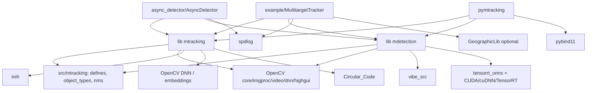
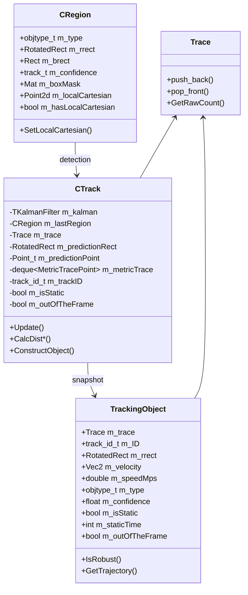
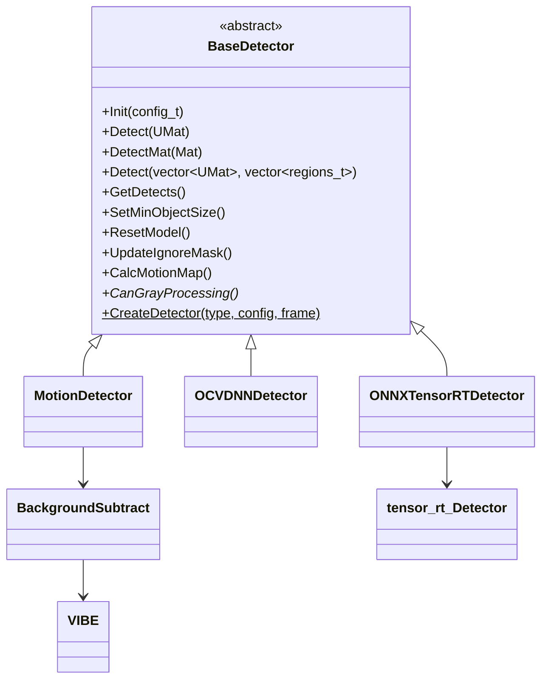

# Архитектура проекта Multitarget Tracker

> Документ описывает текущее состояние репозитория (ветка `master`, версия CMake-проекта `1.1.0`).
> Анализ выполнен статически, по исходному коду; сборка и запуск примеров не производились.

## 1. Назначение

`Multitarget-tracker` — C++17-библиотека и набор приложений для мультиобъектного
трекинга (MOT) на видео. Конвейер обработки классический:

```text
кадр -> детектор (движение / OpenCV DNN / TensorRT) -> регионы (CRegion)
      -> трекер (сопоставление + фильтр Калмана + траектория) -> TrackingObject
      -> визуализация / логи / подсчёт / геопривязка
```

Поддерживаются:

* детекторы на вычитании фона (VIBE, MOG, GMG, CNT, MOG2) и нейросетевые
  (OpenCV DNN, TensorRT) с обычными, повёрнутыми (OBB) и сегментационными
  моделями (YOLO разных версий, RF-DETR, D-FINE, YOLOE, RT-DETRv4);
* два трекера: «универсальный» (`CTracker`) и ByteTrack (`byte_track::BYTETracker`);
* глобальное сопоставление венгерским алгоритмом или LAPJV;
* фильтры Калмана: линейный и (опционально) unscented/augmented UKF;
* повторное обнаружение потерянных целей визуальными трекерами OpenCV
  (KCF/CSRT/DaSiamRPN/Nano/Vit), детекция «брошенных» объектов, подсчёт
  пересечений линий, ReID-эмбеддинги и гистограммы, геопривязка (ENU).
* Python-обёртку `pymtracking` (pybind11), примеры и два асинхронных
  конвейера.

## 2. Структура репозитория

```text
.
├── CMakeLists.txt                 корневая сборка, опции, установка
├── MTTrackingConfig.cmake.in      шаблон CMake-пакета для потребителей
├── setup.py                       сборка Python-пакета pymtracking
├── demo.py                        демонстрация Python-API
├── README.md                      пользовательская документация
├── data/                          видео, *.ini, *.names, скрипты запуска
├── .github/workflows/             CI: ubuntu build, macOS build, CodeQL
├── src/
│   ├── mtracking/                 «публичное» ядро типов
│   │   ├── defines.h              CRegion, TrackID, enums, математика, helpers
│   │   ├── object_types.*         TypeConverter: строки <-> objtype_t
│   │   └── nms.h                  nms/nms2/nms3
│   ├── Tracker/                   библиотека mtracking
│   │   ├── BaseTracker.*          абстрактный API + фабрика; CTracker
│   │   ├── track.*                CTrack — состояние одной цели
│   │   ├── trajectory.h           Trace, TrajectoryPoint, TrackingObject
│   │   ├── Kalman.*               TKalmanFilter (linear/UKF, point/rect/rrect)
│   │   ├── TrackerSettings.*      настройки трекера И детектора + INI-парсер
│   │   ├── ShortPathCalculator.*  стратегии назначения (Hungarian, LAPJV)
│   │   ├── HungarianAlg/          реализация Манкерса
│   │   ├── LAPJV_algorithm/       реализация Джонкера-Фольгенанта
│   │   ├── byte_track/            ByteTrack + собственные KalmanFilter/lapjv
│   │   └── EmbeddingsCalculator.hpp  ReID через OpenCV DNN
│   ├── Detector/                  библиотека mdetection
│   │   ├── BaseDetector.*         интерфейс, фабрика, motion map, ignore mask
│   │   ├── MotionDetector.*       вычитание фона + контуры
│   │   ├── BackgroundSubtract.*   VIBE / OpenCV bgfg
│   │   ├── vibe_src/              встроенная реализация VIBE
│   │   ├── OCVDNNDetector.*       OpenCV DNN: YOLO/RF-DETR/D-FINE/YOLOE
│   │   ├── ONNXTensorRTDetector.* обёртка над TensorRT-движком
│   │   └── tensorrt_onnx/         вендоренный TensorRT/ONNX-движок и семплы
│   └── python_bind/mtracker.cpp   pybind11-модуль pymtracking
├── async_detector/                отдельное приложение: 4-поточный конвейер
├── example/                       основное приложение и примеры
└── thirdparty/                    inih, spdlog, pybind11, Circular_Code, ruclip
```

### 2.1 Артефакты сборки

| Цель | Тип | Где создаётся |
|---|---|---|
| `mtracking` | SHARED (GCC), STATIC (MSVC и остальные компиляторы) | `src/Tracker` |
| `mdetection` | SHARED (GCC), STATIC (MSVC и остальные компиляторы) | `src/Detector` |
| `inih`, `spdlog` | STATIC | `thirdparty` |
| `yolo_rt_lib` | SHARED | `src/Detector/tensorrt_onnx` (только `BUILD_ONNX_TENSORRT=ON`) |
| `MultitargetTracker` | executable | `example` (по умолчанию) |
| `AsyncDetector` | executable | `async_detector` (опция) |
| `pymtracking` | Python extension | `src/python_bind` (опция) |

Все артефакты принудительно складываются в `./build`
(`CMAKE_BINARY_DIR` переопределяется в корневом `CMakeLists.txt`).

## 3. Слои и зависимости



Особенности слоя:

* **`src/mtracking`** не является отдельной библиотекой, это набор заголовков
  (плюс `object_types.cpp`), которые компилируются в `mtracking`/`mdetection`.
  Имена include-путей плоские: `#include "BaseTracker.h"`, `#include "defines.h"`.
* **`TrackerSettings`** — общий конфиг всего конвейера: и трекинг, и детектор
  (`m_nnWeights`, `m_dnnTarget`, `m_inputSize`, `m_embeddings` и т.д.).
  Фактически это «god object» конфигурации.
* **Детекторы** не зависят от трекера, но зависят от `src/mtracking`.
* **`example`** и **`async_detector`** знают детали обеих библиотек (включая
  `FrameInfo`, `Frame`, логгеры), т.е. приложения тесно связаны с реализацией.
* **`tensorrt_onnx`** — по сути отдельный вендоренный SDK (включая
  `common/sample*.cpp` из TensorRT samples), живущий внутри `src/Detector`.

## 4. Сборка и опции

Корневой `CMakeLists.txt`:

* `cmake_minimum_required(3.16)`, `CMAKE_CXX_STANDARD 17`;
* `find_package(OpenCV REQUIRED)`;
* GNU: `-Wall -Wextra -pedantic-errors`; Release — `-O3 -g -march=native
  -mtune=native -funroll-loops -DNDEBUG`;
* MSVC: `/W4 /utf-8`, Release — `/MD /Ox /Ob2 /Oi /Ot /arch:AVX2 /fp:fast`;
* OpenMP подключается при `find_package(OpenMP)`;
* `CMAKE_BINARY_DIR` жёстко указывает на `<source>/build`.

Опции:

| Опция | По умолчанию | Что включает |
|---|---|---|
| `BUILD_EXAMPLES` | ON | `example/` (`MultitargetTracker`) |
| `BUILD_CARS_COUNTING` | OFF | пример подсчёта машин + геопривязка |
| `BUILD_ASYNC_DETECTOR` | OFF | `async_detector/AsyncDetector` |
| `BUILD_ONNX_TENSORRT` | OFF | TensorRT/ONNX-бэкенд (`yolo_rt_lib`) |
| `MTRACKER_PYTHON` | OFF | Python-модуль `pymtracking` |
| `USE_OCV_DNN` | ON | `OCVDNNDetector` (OpenCV DNN) |
| `USE_OCV_BGFG` | ON при наличии contrib | MOG/GMG/CNT из `bgsegm` |
| `USE_OCV_KCF` | ON при наличии contrib | визуальные трекеры OpenCV для потерянных целей |
| `USE_OCV_UKF` | OFF | Unscented Kalman из contrib |
| `USE_OCV_EMBEDDINGS` | ON | ReID-эмбеддинги через `cv::dnn` |
| `USE_CLIP` | OFF | классификация RuCLIP в примере motion |
| `USE_GEOGRAPHICLIB` | OFF | `GeographicLib::LocalCartesian` для ENU |
| `SILENT_WORK` | OFF | вырезает `imshow`/`waitKey` |

Python-пакет собирается `setup.py` (setuptools + CMake), кладёт `pymtracking`
в `build/` и копирует рядом с расширением. Версия в `setup.py` — `1.0.1`,
в CMake — `1.1.0`.

## 5. Модель данных

### 5.1 Основные типы



* **`CRegion`** (`src/mtracking/defines.h`) — результат детектора. Хранит
  одновременно `RotatedRect` и `Rect`; конструкторы из `Rect`/`RotatedRect`
  согласуют их (`B2RRect`/`R2BRect`), размеры принудительно ≥ 1 только для
  `m_rrect` в части конструкторов. `m_boxMask` — маска сегментации (заполняется
  TensorRT-детектором), `m_localCartesian` — координаты центра (в метрах ENU)
  для геопривязки, заполняются приложением.
* **`CTrack`** (`src/Tracker/track.h`) — внутренняя цель: фильтр, последний
  регион, траектория, тип с «сглаживанием» (`m_currType`/`m_lastType`),
  ReID-эмбеддинг/гистограмма, метрическая траектория для скорости, флаг
  статичности, внешний визуальный трекер.
* **`Trace`/`TrajectoryPoint`** (`src/Tracker/trajectory.h`) — история
  предсказанных (и, для части точек, «сырых») позиций с временем кадра.
* **`TrackingObject`** — публичный снимок трека: прямоугольник, скорость,
  траектория, тип, уверенность, статичность, «вышел за кадр», `speedMps`.
  Метод `IsRobust()` — эвристика «показывать ли трек» (длина траектории,
  доля реальных детекций, соотношение сторон).
* **`track_id_t`** — `TrackID<size_t>`: обёртка над числом с `ID2Str`,
  `Str2ID`, `NextID`, `ID2Module`; специализация `std::hash`.

### 5.2 Перечисления

`tracking::Detectors` (`Motion_VIBE..DNN_OCV`), `TrackerTemplate`
(`UniversalTracker`, `ByteTrack`), `DistType` (7 метрик), `FilterGoal`
(center/rect/rrect), `KalmanType` (linear/UKF/augmented UKF), `MatchType`
(Hungarian/LAPJV), `LostTrackType` (none/KCF/CSRT/DaSiamRPN/Nano/Vit).

Числовые значения `Detectors`/`DistType`/`FilterGoal`/... являются частью
внешнего контракта: они используются в INI-файлах и в Python-биндингах.

## 6. Трекер

### 6.1 Публичный API

```cpp
class BaseTracker {
    virtual void Update(const regions_t&, cv::UMat frame, time_point_t) = 0;
    virtual void Update(const regions_t&, cv::UMat, time_point_t, tracking::DistType);
    virtual void UpdateMat(const regions_t&, cv::Mat, time_point_t);
    virtual void GetTracks(std::vector<TrackingObject>&) const = 0;
    virtual std::vector<TrackingObject> GetTracksCopy() const;
    virtual void GetRemovedTracks(std::vector<track_id_t>&) const = 0;
    static std::unique_ptr<BaseTracker> CreateTracker(const TrackerSettings&, float fps);
};
```

`CreateTracker` выбирает `CTracker` или `byte_track::BYTETracker` по
`settings.m_tracker`. Кадр передаётся как `cv::UMat` (по значению — копируется
только заголовок).

### 6.2 CTracker: шаг обновления

`CTracker::Update` (`src/Tracker/BaseTracker.cpp`) на каждом кадре:

1. запоминает время кадра, очищает список удалённых ID;
2. `UpdateTrackingState` — основной алгоритм;
3. копирует текущий кадр в `m_prevFrame` (используется для визуальных
   трекеров/статики, см. замечания в roadmap).

`UpdateTrackingState`:

```text
1. (опционально) CalcEmbeddins: гистограммы и ReID-эмбеддинги для всех регионов
2. для каждого трека: KalmanPredictPoint()/KalmanPredictRect()
3. CreateDistaceMatrix: cost[track][region] = сумма взвешенных метрик
4. ShortPathCalculator::Solve -> assignmentT2R
5. отбросить пары с cost > distThres
6. удалить треки: потеряны дольше max_lost_time | вышли за кадр | статический таймаут
7. для непривязанных регионов создать новые CTrack
8. для назначенных треков: Kalman correct, обновление lastRegion/траектории/статики
   (OpenMP parallel for), для остальных — только предсказание
```

Выход — `GetTracks` конструирует `TrackingObject` из каждого `CTrack`
(траектория копируется целиком).

### 6.3 Метрики расстояния

Веса задаются массивом `m_distType[DistType]`, сумма должна быть равна 1
(`CheckDistance`/`SetDistances`). В `CreateDistaceMatrix`:

| Метрика | Источник | Примечание |
|---|---|---|
| `DistCenters` | эллипс предсказания (`CalcPredictionEllipse` + `IsInsideArea`) | учитывает скорость |
| `DistRects` | эллипс + отношение ширины/высоты | |
| `DistJaccard` | IoU bounding rect | |
| `DistHist` | `cv::compareHist(BHATTACHARYYA)` | ROI кадра |
| `DistFeatureCos` | косинус ReID-эмбеддингов | |
| `DistMahalanobis` | `cv::Mahalanobis` | |
| `DistLocalCartesian` | евклид в ENU, метры | порог `m_distThresLocalCartesian` |

Дополнительно проверяется совместимость типов (`CheckType` + `m_nearTypes`):
несовместимая пара получает `maxPossibleCost`.

### 6.4 Решатели задачи назначения

* `SPHungrian` — `AssignmentProblemSolver` (Манкерс, O(N³)), матрица
  `cost[track + region * tracks]`.
* `SPLAPJV` — прямоугольная задача приводится к виду `rows <= cols`,
  вызывается `lap()` из `LAPJV_algorithm`.

Оба получают `maxCost` (для LAPJV игнорируется).

### 6.5 Фильтр Калмана

`TKalmanFilter` (`src/Tracker/Kalman.cpp`) поддерживает комбинации:

| Модель | Состояние | Измерение |
|---|---|---|
| point, const velocity | x, y, vx, vy | x, y |
| point, const acceleration | x, y, vx, vy, ax, ay | x, y |
| rect, const velocity | x, y, w, h, vx, vy, vw, vh | x, y, w, h |
| rect, const acceleration | x, y, w, h, vx, vy, vw, vh, ax, ay, aw, ah | x, y, w, h |
| rrect, const velocity | x, y, w, h, angle, vx, vy, vw, vh, va | x, y, w, h, angle |
| UKF/augmented UKF | 6 (point) или 8 (rect) | 2 или 4 |

Инициализация выполняется по первым двум детекциям (линейная регрессия),
до этого фильтр не работает и трек использует «сырые» координаты.
Для линейной модели есть «inertia correction»: `m_deltaTime` адаптивно
меняется в диапазоне `[dt, 2*dt]` в зависимости от невязки.

### 6.6 Визуальные трекеры потерянных целей

При `FilterGoal = FilterRect` и `LostTrackType != TrackNone` `CTrack` держит
`cv::Tracker` (KCF/CSRT/DaSiamRPN/Nano/Vit). На кадре без детекции трекер
обновляется по ROI вокруг предсказания; если IoU с детекцией < 0.5 —
трекер переинициализируется. Требует `USE_OCV_KCF` и `opencv_contrib`.

### 6.7 ByteTrack

`byte_track::BYTETracker` — независимая реализация ByteTrack: собственный
`KalmanFilter` (8-мерное состояние `x, y, a, h, ...`), собственный `lapjv`,
ассоциация в два этапа (высокие/низкие confidence), буфер потерянных треков,
дедупликация. Вход — `regions_t`, кадр игнорируется; выход — `TrackingObject`
(без статики и без масок).

## 7. Детекторы

### 7.1 Иерархия и фабрика



`CreateDetector` возвращает `unique_ptr`; `nullptr` означает ошибку
инициализации. `CreateDetectorKV` — вариант с `KeyVal`
(используется Python-биндингом).

### 7.2 MotionDetector

`BackgroundSubtract` создаёт модель (`VIBE`, `MOG`, `GMG`, `CNT`, `MOG2`),
`Subtract` даёт бинарную маску, `DetectContour` находит контуры и строит
`CRegion` (обычный или повёрнутый прямоугольник). `CalcMotionMap` рисует
накопленную карту движения.

### 7.3 OCVDNNDetector

`Init` читает модель (`readNet`), настраивает backend/target, список классов,
порог, кропы; по форме выходов пытается определить входной размер.
`Detect` либо обрабатывает кадр целиком, либо режет на перекрывающиеся кропы
(`GetCrops`) и объединяет результаты через `nms3`. `DetectInCrop` вызывает
`net.forward` и специализированный парсер по `m_netType`:

* `ParseOldYOLO` — `DetectionOutput`/`Region` (YOLOv3/v4, SSD);
* `ParseYOLOv5/8/9/10/11` — `[N, C]`/`[C, N]` выходы;
* `ParseYOLOv5_8_11_obb` — повёрнутые боксы;
* `ParseYOLOv5_8_11_seg`, `ParseYOLOEMask` — только боксы (маски не извлекаются);
* `ParseRFDETR`, `ParseRFDETR_IS` — два выхода (boxes, labels);
* `ParseDFINE`, `ParseDFINE_IS`, `ParseYOLOv26*` — выходы DETR-подобных моделей;
* `ParseYOLOE` — YOLOE.

### 7.4 ONNXTensorRTDetector + tensorrt_onnx

`ONNXTensorRTDetector` переводит `config_t` в `tensor_rt::Config`, создаёт
`tensor_rt::Detector` (pimpl в `class_detector.cpp`), который по `net_type`
выбирает конкретный класс-парсер (`YOLOv5_bb_onnx`, `DFINE_bb_onnx`,
`RFDETR_bb_onnx`, ...). `YoloONNX` — общий движок:

* загружает/строит TensorRT engine (файл `*.engine` кэшируется рядом с моделью);
* держит `BufferManager` (host/device буферы), `IExecutionContext`;
* `ProcessInputAspectRatio` делает letterbox-ресайз входа;
* `VerifyOutputAspectRatio` копирует выходы на хост и вызывает `GetResult`
  конкретной модели;
* `Detect` поддерживает батч кадров.

Для сегментационных моделей заполняется `Result::m_boxMask`, который затем
попадает в `CRegion::m_boxMask` и используется при отрисовке/карте движения.

## 8. Конфигурация

### 8.1 INI

`ParseTrackerSettings` (`src/Tracker/TrackerSettings.cpp`) читает два раздела:

```ini
[detection]
detector_backend = 6          # 5 = TensorRT, 6 = OpenCV DNN
nn_config / nn_weights / class_names
confidence_threshold, max_crop_ratio, max_batch, gpu_id
net_type, inference_precision, ocv_dnn_target, ocv_dnn_backend
input_width, input_height, video_memory, white_list

[tracking]
tracker_type, distance_type, kalman_type, filter_goal, lost_track_type,
match_type, use_aceleration, delta_time, accel_noise, dist_thresh,
local_cartesian_dist_thresh, min_area_radius_pix, min_area_radius_k,
max_lost_time, max_trace_len, detect_abandoned, min_static_time,
max_static_time, max_speed_for_static, bytetrack_*
```

Пустой/отсутствующий файл => `false`, используются значения по умолчанию.
INI-файлы лежат в `data/` (`settings*.ini`), часть из них содержит
абсолютные пути разработчика.

### 8.2 CLI

`example/main.cpp` (OpenCV `CommandLineParser`):
`<video> --example= --start_frame= --end_frame= --end_delay= --out=
--show_logs= --gpu= --async= --log_res= --cvat_res= --settings=
--batch_size= --write_n_frame= --heat_map= --geo_bind=
--contrast_adjustment=`.

`async_detector/main.cpp` — сокращённый набор (`--out`, `--start_frame`,
`--end_frame`, `--end_delay`, `--show_logs`, `--gpu`,
`--contrast_adjustment`).

### 8.3 Python

`KeyVal` (список пар ключ-значение) преобразуется в `config_t` и передаётся в
`BaseDetector::CreateDetectorKV`; трекер настраивается через
`TrackerSettings` и `MTracker(settings, fps)`.

## 9. Потоки выполнения

### 9.1 Синхронный (`VideoExample::SyncProcess`)

```text
capture -> detector.Detect(batch) -> tracker.Update(каждый кадр батча)
        -> GetTracks -> draw/log -> VideoWriter -> imshow/waitKey
```

Один поток, поддерживается батч (`--batch_size`) на уровне детектора.

### 9.2 Двухпоточный (`VideoExample::AsyncProcess`)

```text
[CaptureAndDetect] capture + detect -> FrameInfo[2] (double buffer)
[main]             wait(m_captured) -> tracker.Update -> draw/write -> release
```

Синхронизация — `std::mutex` + `std::condition_variable` + `std::atomic<bool>
m_captured` на каждом из двух `FrameInfo`; таймауты 60 с.

### 9.3 Четырёхпоточный (`async_detector`)

```text
[CaptureThread]  capture -> FramesQueue::AddNewFrame -> (join остальных)
      |
      +-> [DetectThread]  GetLastUndetectedFrame -> detector.Detect -> m_regions
      |
      +-> [TrackingThread] GetFirstDetectedFrame -> tracker.Update/GetTracks
      |
      +-> [main]  GetFirstProcessedFrame -> draw/write/imshow
```

`FramesQueue` — список `shared_ptr<FrameInfo>` под мьютексом; у каждого кадра
атомарные состояния `m_inDetector`/`m_inTracker`. Детектор берёт **последний**
необработанный кадр, промежуточные помечает `StateSkipped` (они всё равно
проходят через трекер без детекций); трекер берёт самый ранний готовый кадр.
Очередь ограничена 15 кадрами, лишние молча отбрасываются.

### 9.4 Параллелизм внутри трекера

`CTrack::Update` для всех треков выполняется под `#pragma omp parallel for`;
независимые треки обновляются параллельно. VIBE и отрисовка motion map также
используют OpenMP.

## 10. Расширение

* **Новый детектор** — унаследовать `BaseDetector`, реализовать `Init`,
  `Detect`, `CanGrayProcessing`; добавить значение в `tracking::Detectors`,
  ветку в `BaseDetector::CreateDetector` (и, при необходимости, в
  `TrackerSettings::m_detectorBackend`/INI).
* **Новый трекер** — унаследовать `BaseTracker`, добавить значение в
  `tracking::TrackerTemplate` и ветку в `BaseTracker::CreateTracker`.
* **Новая метрика** — добавить `DistType`, поле в `TrackerSettings::m_distType`
  (и обновить `CheckDistance`), реализовать расчёт в
  `CTracker::CreateDistaceMatrix`/`CTrack`.
* **Новая модель TensorRT** — добавить `ModelType`, класс-наследник
  `YoloONNX` с `GetResult` и ветку в `YoloONNXImpl::Init`.
* **Новая модель OpenCV DNN** — добавить `ModelType` и парсер, включить его
  в `DetectInCrop`.

## 11. Тестирование и CI

В репозитории нет unit/integration-тестов. CI (`.github/workflows`):

* `ubuntu.yml` — `cmake .. && make` с дефолтными опциями (без TensorRT,
  Python, contrib-опций), без тестов;
* `macos.yml` — аналогичная сборка;
* `codeql-analysis.yml` — статический анализ C++.

Python-обёртка, `async_detector`, `BUILD_CARS_COUNTING`, `BUILD_ONNX_TENSORRT`
и `USE_OCV_UKF` в CI не собираются.

## 12. Границы и известные ограничения архитектуры

Кратко (подробный разбор — в [roadmap.md](roadmap.md)):

1. `TrackerSettings` смешивает конфигурацию трекера и детектора; его
   копируют/пересоздают в примерах.
2. Дублирование: два Калмана, два LAPJV, две реализации `GetTracks`,
   два способа задать «потерянный трекер».
3. Публичные заголовки и API не отделены от внутренних (`track.h`,
   `Kalman.h`, `FrameInfo` в примерах); README ссылается на удалённый
   `mtracking/Ctracker.h`.
4. Ошибки конфигурации/инициализации часто обрабатываются через
   `assert`/`exit`/`nullptr`-разыменование, а не через исключения/коды возврата.
5. Детекторы сильно завязаны на конкретный формат выходов моделей; имена
   выходов и типы тензоров не проверяются.
6. Нет тестов и воспроизводимого CI для большинства опций; сборка
   Release с `-march=native` не переносима.
7. Python-обёртка отстала от C++ API и в текущем виде не собирается.
8. Глобальное изменяемое состояние (`TypeConverter::m_typeNames`) не
   потокобезопасно и делает ID типов зависящими от порядка инициализации.

## 13. Карта файлов (кратко)

| Файл | Роль |
|---|---|
| `src/mtracking/defines.h` | `CRegion`, `TrackID`, enums, `Clamp`, `DrawFilledRect`, `SaveMat`, регрессия |
| `src/mtracking/object_types.*` | глобальный реестр типов объектов |
| `src/mtracking/nms.h` | NMS (3 варианта) |
| `src/Tracker/BaseTracker.*` | `BaseTracker`, `CTracker`, фабрика |
| `src/Tracker/track.*` | `CTrack`: фильтр, дистанции, статика, внешний трекер |
| `src/Tracker/trajectory.h` | `Trace`, `TrackingObject`, LS-аппроксимация |
| `src/Tracker/Kalman.*` | `TKalmanFilter` |
| `src/Tracker/TrackerSettings.*` | конфиг + INI |
| `src/Tracker/ShortPathCalculator.*` | фабрика решателей назначения |
| `src/Tracker/HungarianAlg/HungarianAlg.cpp` | Манкерс |
| `src/Tracker/LAPJV_algorithm/lap.cpp` | LAPJV |
| `src/Tracker/byte_track/*` | ByteTrack |
| `src/Tracker/EmbeddingsCalculator.hpp` | ReID |
| `src/Detector/BaseDetector.*` | интерфейс/фабрика детекторов |
| `src/Detector/MotionDetector.*`, `BackgroundSubtract.*`, `vibe_src/*` | motion-детекторы |
| `src/Detector/OCVDNNDetector.*` | OpenCV DNN-детектор |
| `src/Detector/ONNXTensorRTDetector.*`, `tensorrt_onnx/*` | TensorRT-детектор |
| `src/python_bind/mtracker.cpp` | pybind11-модуль |
| `async_detector/*` | 4-поточный пример |
| `example/*` | основное приложение, примеры, CSV/CVAT-логи |
